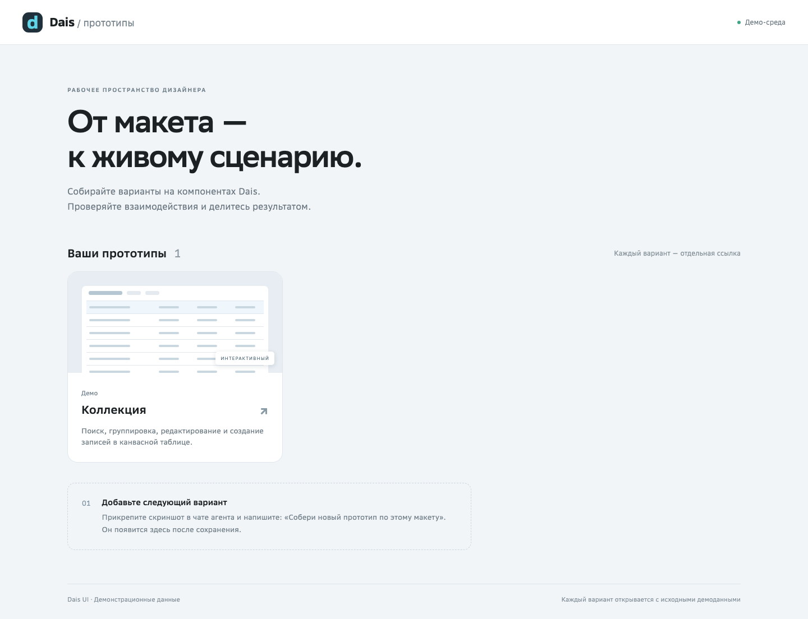
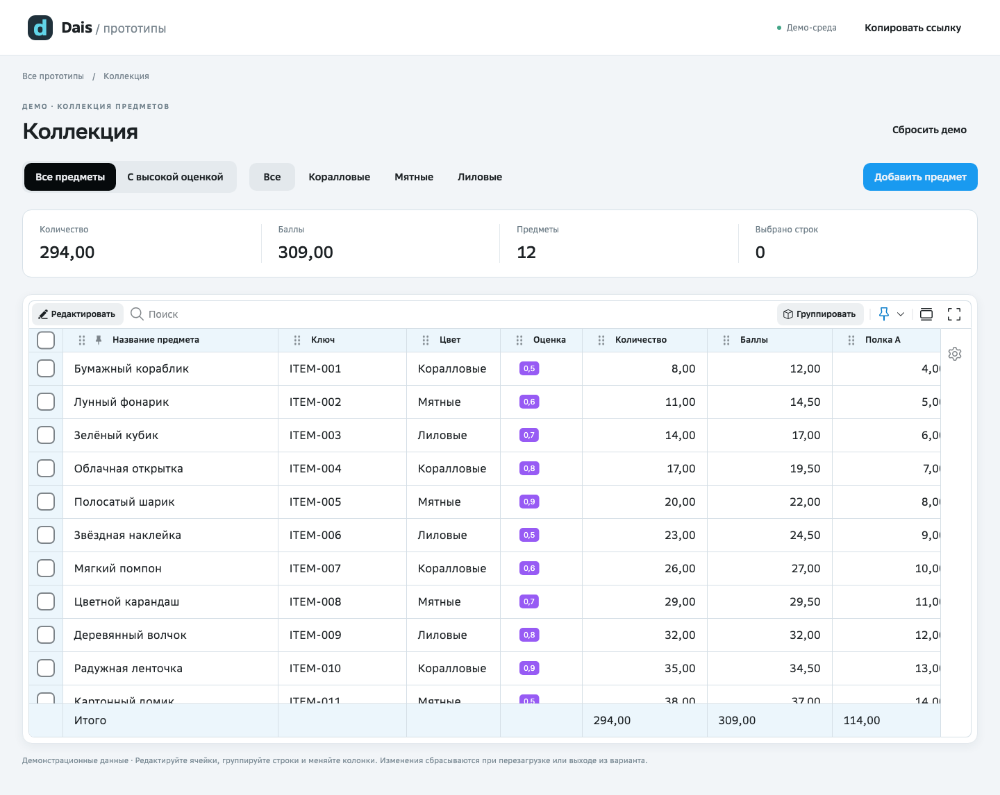

# Dais · прототипы

Готовое рабочее место дизайнера: **Vite + React + Dais UI + локальный MCP + четыре навыка агента**.
Прикрепляйте макеты в чат Codex, Claude Code или поддерживаемого клиента GigaCode, собирайте интерактивные варианты и передавайте одним HTML-файлом или публикуйте галерею на GitHub Pages.

## Выберите результат

| Вариант | Что получит коллега | Что нужно автору |
| --- | --- | --- |
| [HTML-файл](docs/HTML_EXPORT.md) | Один файл с приложением, библиотеками, данными и шрифтами; открывается без сети | Папка проекта и Node.js/npm |
| [GitHub Pages через Actions](docs/PUBLISHING.md) | Ссылку на страницу; обновления публикуются после push | Свой GitHub-репозиторий, Git и доступ к Pages; gh необязателен |
| Пока локально | Просмотр на компьютере автора | Папка проекта и Node.js/npm |

ИИ-клиент нужен для работы с агентом во всех вариантах. Способы можно менять и использовать вместе. Если вы ещё не выбрали результат, агент уточнит это перед подготовкой/созданием прототипа. Уже сделанный выбор не нужно повторять при каждой правке.



## Первый запуск

**Новый компьютер или нет опыта с терминалом? Начните с [пошагового гида для дизайнера](docs/GETTING_STARTED.md): macOS/Windows, установка программ, вход в аккаунты, скачивание проекта и публикация.** Ниже — короткий путь для уже подготовленного компьютера.

1. Для HTML или локальной работы получите папку проекта: **Code → Download ZIP** и распакуйте либо используйте готовую копию. ZIP нужен только как способ скачивания исходников; готовый результат передаётся одним HTML.
2. Для Pages создайте собственный репозиторий через **Use this template → Create a new repository**, затем склонируйте его. [Инструкция с картинками](https://docs.github.com/en/repositories/creating-and-managing-repositories/creating-a-repository-from-a-template). Откройте папку выбранной копии в агенте.
3. Нужен [Node.js](https://nodejs.org/en/download) **22.14+ из ветки 22 или 24+** с npm. Если уже установлен nvm: `nvm install && nvm use`. Для Pages также нужен [Git](https://git-scm.com/downloads); [GitHub CLI](https://cli.github.com/) упрощает настройку, но необязателен.
4. Напишите агенту:

   > Прочитай AGENTS.md и подготовь проект для прототипирования по навыку dais-setup.

   Или выполните в терминале:

   ```sh
   npm run setup
   npm run dev
   ```

5. Перезапустите агент в этой папке после setup для подхвата MCP и навыков. При запросе клиента разрешите работу с проектом и сервером `dais-ui`. Откройте локальную ссылку, напечатанную Vite.

Подготовка устанавливает пакеты из lockfile, создаёт конфиги MCP **только внутри проекта** и проверяет соединение. Повторная подготовка сохраняет макеты. Ничего не устанавливается в исходные репозитории Dais, Plasma или Glide.

## Собрать макет

Прикрепите PNG в чат агента и напишите:

> Собери новый прототип «План команды» по этому скриншоту. Используй компоненты Dais UI и сохрани состав и начальные состояния макета. Сохрани предыдущие варианты.

Агент создаст отдельный экран по содержимому PNG в `src/prototypes`. Форма становится новой страницей формы; существующая «Коллекция» остаётся примером таблицы. Если написать «Встрой эту форму в прототип collection», агент изменит указанный вариант. Галерея автоматически покажет новый экран. Для создания вручную:

```sh
npm run prototype:new -- team-plan "План команды"
```

Адрес варианта: `http://localhost:5173/#/team-plan` (порт смотрите в терминале).
Для сохранения исходника при создании: `npm run prototype:new -- team-plan "План команды" --reference "/путь/макет.png"`. PNG хранится в `.references/team-plan/source.png`, не входит в Git и сборки. Снимки результата хранятся отдельно. Для просмотра без шапки галереи: `http://localhost:5173/?standalone=1#/team-plan`.
PNG задаёт внешний вид; поведение невидимых состояний лучше указать одной фразой. Клиент/модель должны поддерживать изображения и выполнение команд. Один skill не добавляет эти возможности модели.



В стартовой коллекции работают создание записи, поиск, фильтр по цвету, группировка, сортировка, выбор строк, редактирование и итоги. Изменения действуют только в открытом варианте: перезагрузка страницы, выход в галерею или «Сбросить демо» возвращают исходные данные. Кнопка «Сохранить» завершает редактирование внутри текущего просмотра.

## Репозиторий и состояние демо

**Репозиторий** — папка проекта с кодом, картинками и историей изменений. Этот репозиторий служит шаблоном; дизайнер создаёт из него собственную копию. «Репозиторий проекта» означает копию, открытую в агенте. Адрес GitHub, куда уйдёт код, показывает `git remote -v`.

Начальное состояние задано в коде. Демо не сохраняет изменения таблицы в localStorage, sessionStorage или на сервер. Каждый посетитель начинает с демоданных выбранной сборки и может взаимодействовать с ними независимо.

Чтобы изменить постоянное начальное состояние, попросите агента изменить данные в коде, затем заново экспортируйте HTML или опубликуйте страницу.

## Передать результат

**Файлом:** «Собери прототип collection в один HTML без галереи». Агент выполнит `npm run export:html -- collection` и выдаст `dist-html/collection/index.html`. В файл войдёт только выбранный экран с его зависимостями. Получатель скачивает файл и открывает в браузере; установка библиотек не нужна. [Экспорт HTML](docs/HTML_EXPORT.md).

**Ссылкой:** «Опубликуй на GitHub Pages через Actions и дай ссылку». Агент настроит Pages, отправит commit и проверит результат публикации. С gh доступны команды publish:*; без gh настройте Pages в браузере, а commit/push выполняются обычным Git. [Публикация](docs/PUBLISHING.md).

## Агенты

| Клиент | Навыки | MCP после setup |
| --- | --- | --- |
| Codex | `.agents/skills` | `.codex/config.toml` |
| Claude Code | `.claude/skills` | `.mcp.json` |
| GigaCode CLI | `.gigacode/skills` | `.gigacode/settings.json` |
| GigaCode VS Code | Если не обнаружены, попросите прочитать SKILL.md | `.gigacode_vsc/gigacode.jsonc` |

Исходник навыков один: `.agents/skills`; копии для клиентов обновляются `npm run skills:sync`.
Конфиги MCP содержат пути вашего компьютера, поэтому исключены из git. Для нового клона выполняйте setup заново.
Файлы для клиентов подготовлены по официальной документации. Реальная активация и передача PNG зависят от версии/политик клиента; актуальные границы проверки перечислены в [отчёте](docs/VALIDATION.md).

## Проверки и команды

```sh
npm run doctor          # версии и независимость зависимостей
npm run mcp:check       # реальные обращения к MCP
npm run build           # TypeScript + production build
npm test                # сохранность настроек и макетов
npm run export:html -- collection # один экран: dist-html/collection/index.html
```

Браузерных автотестов и установки браузера в проекте нет. Для нового экрана, заметной визуальной правки или ошибки взаимодействия агент проверяет затронутую страницу доступными средствами браузера. Мелкие очевидные изменения не требуют скриншота; связанные правки проверяются одним просмотром. Если браузер недоступен, агент сообщает, что осталось проверить. Успешная сборка не доказывает корректность всех действий.

Если npm не найден — установите Node и откройте терминал заново. Если MCP не появился — перезапустите агент и проверьте его доверие проекту. Не используйте `--force`/`--legacy-peer-deps` для исправления установки: lockfile должен работать без них.

Обновление пакетов выполняется отдельно и проверяется на существующих вариантах. [Как поддерживать шаблон](docs/MAINTAINING.md).

## Устройство

- `src/prototypes/` — независимые варианты дизайнера.
- `.references/` — локальные исходные PNG, вне Git и сборок.
- `src/standalone.tsx` — вход автономного HTML одного выбранного варианта.
- `src/recipes/` — общая рабочая композиция таблицы и демонстрационные данные.
- `scripts/` — подготовка, диагностика, создание варианта и публикация.
- `.agents/skills/` — подготовка, сборка макетов, публикация, автономный HTML.
- `.github/workflows/pages.yml` — проверки и размещение на Pages из `main`.

Это приложение-потребитель `@daisforge/ui`. Plasma и форк Glide устанавливаются как зависимости Dais. MCP нужен агенту при разработке; опубликованная страница работает без агента и MCP.
